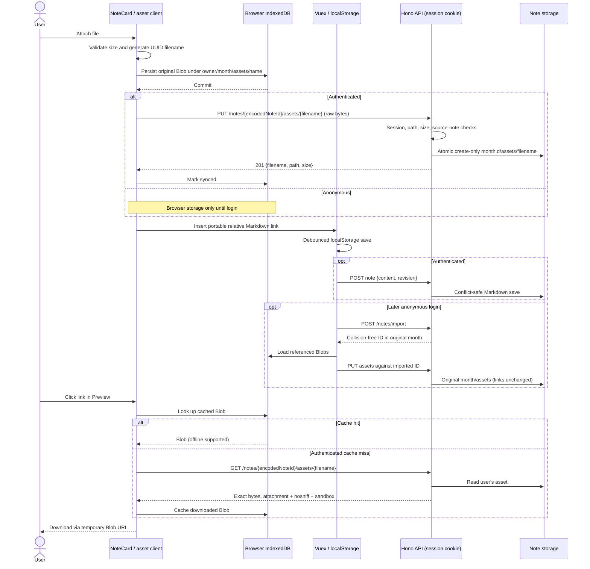
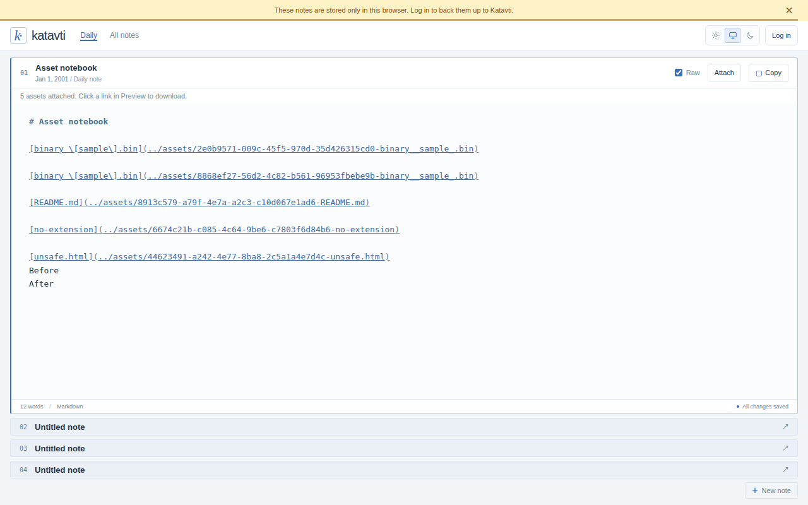
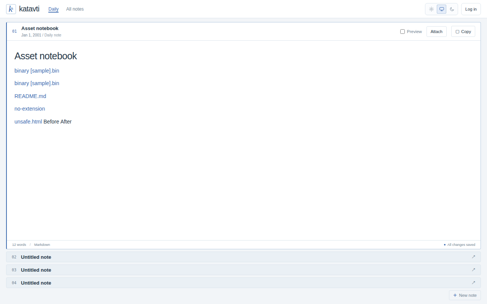
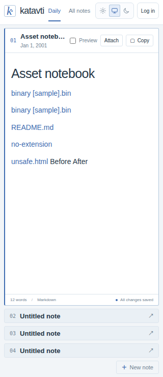
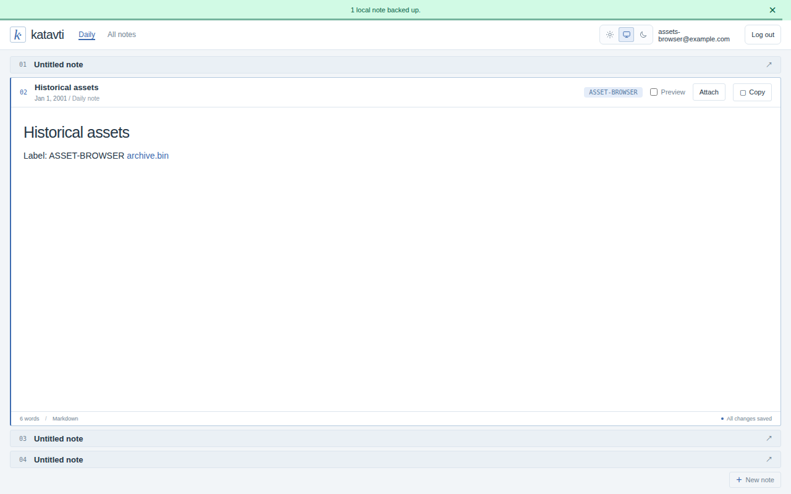
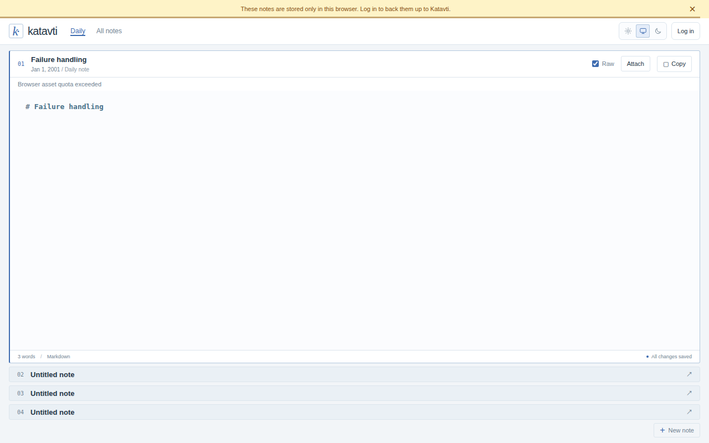
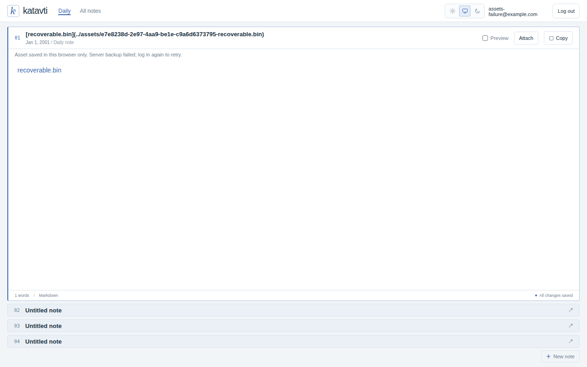
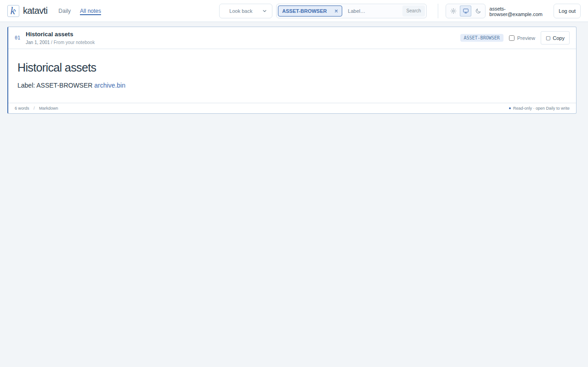
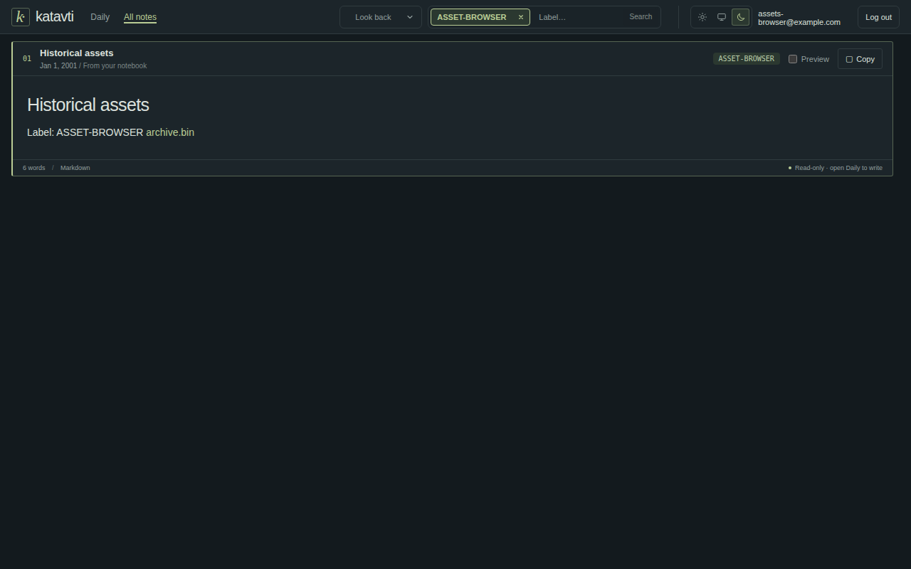

# Note assets — implementation and local verification report

Date: 2026-10-29. Scope: prototype, this machine only.

## Delivered behavior

- **Attach** on editable Daily notes accepts multiple files of **any type**, including binary, Markdown, HTML, extensionless, and empty files. The per-file limit is 50 MiB.
- Raw mode inserts links at the editor selection; Preview appends them. The existing autosave persists the Markdown.
- Links use `[original name](../assets/<uuid>-<safe-name>)`. UUIDs prevent duplicate-name collisions; Markdown labels escape brackets/backslashes.
- Browser assets use IndexedDB `katavti.assets.v1`, object store `assets`, containing the original Blob and metadata. Keys follow `<owner>/<year>/<month>.d/assets/<filename>`. Notes remain in `localStorage` (`katavti.notes.v1`).
- Authenticated uploads also go to the selected server storage. Filesystem paths are `<dataDir>/<email>/<year>/<month>.d/assets/<filename>`, a sibling of the note's `workspaces-YYYY-MM-DD` directory. Azure uses the equivalent blob prefix.
- The **note's month** controls placement, even when it is years older than the upload date. Anonymous note import keeps its date/month and uploads referenced assets against the collision-free imported note ID without rewriting relative links.
- Links download from both Daily and All notes. A second device fetches uncached bytes and saves them to IndexedDB; subsequent clicks work offline.
- A browser quota or size failure displays an alert and inserts no broken link. A server upload failure preserves browser bytes and the link, displays a browser-only warning, and retries referenced unsynced assets on the next explicit login.
- Startup now refreshes notes after an existing session resolves, fixing a race that otherwise hid remote asset links on a second device's initial page load.

## API contract

Base path: `/api/v1beta`. `{noteId}` is the existing URL-encoded note ID, for example `2001%2Fjanuary.d%2Fworkspaces-2001-01-01%2Fworkspace-2.md`.

| Method / route | Request | Successful response |
| --- | --- | --- |
| `PUT /notes/{noteId}/assets/{filename}` | Session cookie; raw binary body, any MIME type, up to 50 MiB | `201 { "filename": "<uuid>-archive.bin", "path": "../assets/<uuid>-archive.bin", "size": 7 }` |
| `GET /notes/{noteId}/assets/{filename}` | Session cookie | `200`, exact binary bytes |
| `POST /notes/{noteId}` | Existing `{ content, revision }` JSON contract | Existing conflict-safe note save result |
| `POST /notes/import` | Existing `{ id, content }` JSON contract | Collision-free imported ID and note; referenced asset uploads follow |

The asset filename must be a UUID v4 followed by a 1–120-character safe filename (`A-Z`, `a-z`, numbers, dot, underscore, hyphen). The server derives the user from the session, never from client-supplied paths. Upload requires an existing source note. Assets are month-scoped: notes within the same user's month can refer to the same asset.

Errors: `400` invalid paths/names, `401` no session, `404` missing asset/source note or another user's missing file, `409` an existing filename has different bytes, `413` oversized body. An identical upload retry is accepted without overwriting; filesystem publication uses a completed temporary file plus atomic create-only hard link. Symlinked path components are rejected. Both note-list implementations explicitly exclude assets, including `.md` uploads.

Arbitrary content is **download-only**, not an inline executable document. GET headers include:

```http
Content-Type: application/octet-stream
Content-Disposition: attachment; filename="archive.bin"
X-Content-Type-Options: nosniff
Content-Security-Policy: sandbox; default-src 'none'
Cache-Control: private, no-store
```

Browser downloads use short-lived Blob URLs, not URLs written into notes. HTML/SVG/scripts are not inserted into `v-html` or served as executable pages.

## API sequence diagram

Editable diagram source: [api-sequence.mmd](api-sequence.mmd).

Both diagrams were parsed and rendered in local headless Chrome using the installed Mermaid bundle; see [diagram-check.log](diagram-check.log). Message text avoids literal semicolons, which Mermaid treats as statement separators.



## Verification and logs

All commands were executed through the shared `green` tmux tools; the Bash tool was not used. Tests started isolated loopback API/Vite servers with temporary note/session directories and fresh headless Chrome browser contexts. They did not access real browser notes, account data, the local Kubernetes cluster, Azure, SMTP, or Google login. The asset browser tests block non-loopback requests (responding with empty content), and fake login is development-only. Browser date was fixed to January 1, 2001 while the server retained its actual date, exercising historical-month placement.

| Check | Result | Evidence |
| --- | --- | --- |
| Full server regression suite | **79 tests passed**, 18 files | [tests.log](tests.log) |
| Full client unit suite | **72 tests passed**, 17 files | [tests.log](tests.log) |
| Final asset HTTP + headless run | **7 tests passed**, 2 files | [headless-tests.log](headless-tests.log) |
| Production TypeScript + Vue + Vite build | **Passed** | [build.log](build.log) |
| Browser HTTP/console/download events | Exact-byte checks passed; no page exceptions | [browser.log](browser.log) |
| `git diff --check` | Passed | Run through tmux |

Reproduce:

```sh
PLAYWRIGHT_CHANNEL=chrome npm test
npm run build
PLAYWRIGHT_CHANNEL=chrome npx vitest run server/test/e2e/assets.test.ts server/test/e2e/assets-browser.test.ts
```

Installed Chrome was used because the Playwright package's requested bundled Chromium revision was not installed. No browser installation/network download was needed. The tests automatically close browsers/servers and remove their temporary storage. Screenshot/log artifacts remain here.

Coverage includes real editor selection insertion; duplicate names; binary bytes with NUL/255/128; empty/extensionless/Markdown/HTML files; reload; offline cached downloads; 320px layout; authenticated upload from Preview; historical month; collision-free anonymous import; second-device fetch and IndexedDB cache; All notes and dark theme; browser quota failure; browser/API size limits; simulated server failure and successful retry; session/user isolation; traversal/symlink rejection; immutable retries; and `.md` asset exclusion from note lists. Azure behavior is covered by a **local mocked boundary** test only, not a live cloud test.

The browser log's single expected console error is the deliberately simulated `503` asset-upload failure. The final retry returns `201`. The build has Vite's non-fatal >500 kB bundle-size warning; there are no TypeScript/build errors.

## Screenshots

### Anonymous Raw mode — multiple file types and portable links



### Anonymous Preview — clickable download links after reload



### Mobile — 320px, no horizontal overflow



### Authenticated — historical note imported as workspace 2



### Browser storage failure — no broken link inserted



### Server upload failure — local asset stays downloadable



### All notes — read-only notes retain asset download links



### Dark theme



## Prototype limits

- 50 MiB per file; upload/download buffers are not streamed. Browser quotas vary, and clearing/evicting site storage removes browser copies.
- No asset manager, deletion/garbage collection, inline image previews, antivirus scanning, resumable uploads, or automatic background retry. Removing a link does not delete its asset.
- Original filenames are preserved in the local record and Markdown label; a device fetching from the API uses the safe filename suffix for its download name.
- Note and asset writes are separate operations, not a distributed transaction. An import can briefly expose a note before its asset backup completes; failures retain local files and can be retried by login.
- Binary cache entries are account-scoped with an anonymous fallback for imports; the existing browser note store remains shared as before. Live Azure and production deployment were intentionally not tested.

## Main files

- `client/src/api/assets.ts`: IndexedDB, upload, backup, cache, download.
- `client/src/api/local-notes.ts`: import ID tracking and referenced-asset backup.
- `client/src/components/NoteCard.vue`, `MarkdownEditor.vue`: picker, editor insertion, download handling, alerts.
- `client/src/store/index.ts`: login asset backup and session-start refresh.
- `server/src/routes/assets/index.ts`, `data-modules/assets-data.ts`: binary API contract/validation.
- `server/src/data-modules/file-notes-data.ts`, `azure-notes-data.ts`: month asset storage and list exclusion.
- `server/test/e2e/assets.test.ts`, `assets-browser.test.ts`, `server/test/unit/azure-assets.test.ts`: isolated local verification.
